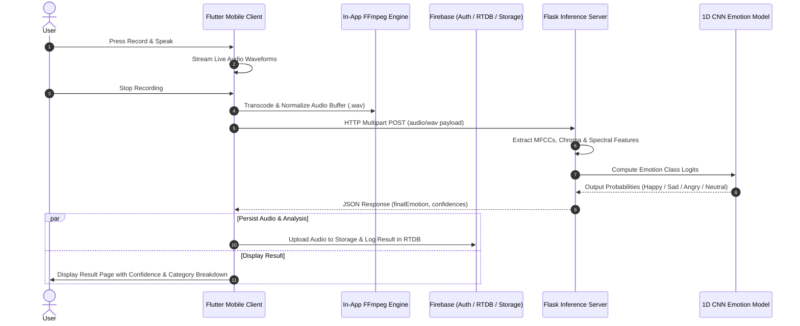

<div align="center">

# 📱 Speech Emotion Recognition (SER) Mobile Application

**Real-Time Affective Voice Computing Client Built with Flutter, Firebase & In-App Waveform Audio Processing**

[](https://flutter.dev/)
[](https://dart.dev/)
[](https://firebase.google.com/)
[](https://ffmpeg.org/)
[-brightgreen.svg)](https://github.com/mahamadAhmed/speech-emotion-recognition)
[](#)
[](https://opensource.org/licenses/MIT)

</div>

---

## 📌 Overview

The **Speech Emotion Recognition (SER) Mobile Application** is a cross-platform mobile client engineered with **Flutter** that empowers users to capture spoken voice clips, analyze vocal acoustic patterns in real time, and inspect emotional states directly on their mobile device.

The app interfaces seamlessly with a high-throughput **Flask REST API** hosting a trained **Deep 1D Convolutional Neural Network (CNN)** (developed in the companion repository [`speech-emotion-recognition`](https://github.com/mahamadAhmed/speech-emotion-recognition)). It features live waveform audio recording, in-device audio normalization via **FFmpeg**, cloud synchronization via **Firebase**, and a personal history vault for replaying past recordings alongside their affective classifications.

---

## 🎯 Key Application Features

* 🎙️ **Live Audio Recording & Visualizer:** In-app microphone acquisition with real-time audio waveform visualization powered by `audio_waveforms`.
* ⚡ **On-Device Audio Processing:** Normalizes and converts captured audio payloads using `flutter_ffmpeg` before multipart network transmission.
* 🧠 **Real-Time Emotion Inference:** Dispatches voice payloads to the classification API to detect 4 primary emotional classes (**Happy**, **Sad**, **Angry**, **Neutral**) with probability distributions.
* 🔐 **Secure Authentication & Cloud Sync:** Complete sign-up, sign-in, and password recovery backed by **Firebase Authentication** and **PHP/MySQL** services.
* 📂 **Audio Replay & History Vault:** Persistent audio recording storage in **Firebase Storage** with classification history logs tracked in **Firebase Realtime Database**.
* 🎨 **Intuitive Multi-Screen Workflow:** Polished onboarding carousels, profile management, and interactive affective category explorer cards.

---

## 🔄 End-to-End System Workflow



---

## 📱 Application Screens & Architecture

```text
lib/
├── firebase_options.dart      # Firebase SDK configuration
├── main.dart                  # Application bootstrap and routing
├── utils.dart                 # Typography, theme palettes, and UI helpers
├── screens/                   # Navigation & User Journey
│   ├── Onboarding-page1.dart  # Interactive introduction carousel (Slide 1)
│   ├── Onboarding-page2.dart  # Feature highlights (Slide 2)
│   ├── Onboarding-page3.dart  # Get started CTA (Slide 3)
│   ├── login-page.dart        # Authentication sign-in form
│   ├── registration-page.dart # Account creation & validation
│   └── loading-screen.dart    # Animated network state indicator
├── page-1/                    # Core Affective Computing Workflows
│   ├── record.dart            # Live microphone capture & waveform visualizer
│   ├── playaudio.dart         # Audio playback controller with seek controls
│   ├── ser-process.dart       # Network upload state & progress indicator
│   ├── Result.dart            # Predicted emotion, confidence gauges, and tags
│   ├── category.dart          # Affective category cards & psychology explorer
│   ├── Description.dart       # Detailed acoustic & psychological definitions
│   ├── history.dart           # Chronological evaluation log list
│   ├── historyPlayAudio.dart  # Historical audio clip player
│   ├── profile.dart           # User profile and account settings
│   └── ForgotPass.dart        # Self-service password reset workflow
└── Server/                    # Backend Integration Layer
    ├── Myconfig.dart          # Inference host endpoint configurations
    └── User.dart              # Data models and session state serialization
```

---

## 🌐 Companion Repositories & Serving Ecosystem

This mobile client is part of a tri-component affective computing system:

1. 🔬 **Model Development & Training:** [`speech-emotion-recognition`](https://github.com/mahamadAhmed/speech-emotion-recognition)  
   Contains signal processing routines (openSMILE / Librosa), exploratory notebooks across RAVDESS, CREMA-D, TESS, and SAVEE datasets, and deep 1D CNN architecture definitions.
2. ⚡ **Inference API Backend:** [`serflask`](https://github.com/mahamadAhmed/serflask)  
   Flask REST service receiving multipart WAV files, extracting acoustic features, and querying the saved CNN model weights.
3. 📱 **Mobile Client:** [`ser-flutter-client`](https://github.com/mahamadAhmed/-SER-Flutter-Application) (This repository)  
   Flutter UI coordinating microphone recording, network requests, audio playback, and user session management.

---

## 🚀 Getting Started & Setup

### Prerequisites
* [Flutter SDK](https://docs.flutter.dev/get-started/install) (`v3.0.0+` recommended)
* [Dart SDK](https://dart.dev/get-dart)
* Android Studio / Xcode with configured emulators or a connected physical device

### 1. Clone the Repository
```bash
git clone https://github.com/mahamadAhmed/-SER-Flutter-Application.git
cd -SER-Flutter-Application
```

### 2. Configure Backend Inference Endpoint
Open `lib/Server/Myconfig.dart` and specify your active Flask inference host:
```dart
class MyConfig {
  // Update with your local IP or production inference host
  String SERVER = "http://192.168.1.100:5000";
}
```

### 3. Install Dependencies
```bash
flutter pub get
```

### 4. Run the Application
```bash
# Launch on available simulator/connected device
flutter run
```

---

## 📦 Key Dependencies

| Dependency | Purpose |
| :--- | :--- |
| `audio_waveforms` | High-performance audio recording and real-time waveform rendering. |
| `flutter_ffmpeg` | Cross-platform audio transcoding and audio stream resampling. |
| `firebase_core` | Firebase application configuration and initialization. |
| `firebase_auth` | User identity lifecycle, authentication tokens, and session handling. |
| `firebase_database` | Real-time synchronization of emotion logs and evaluation metadata. |
| `firebase_storage` | Cloud bucket storage for recorded user voice evaluation clips. |
| `http` | Multipart REST communications with the Flask inference backend. |

---

## 👤 Author & Contact

**Mahamat Ahmat**  
*M.Sc. Artificial Intelligence Engineering — University of Passau*  
*B.Sc. in Artificial Intelligence — Cairo University*

* 🌐 **Portfolio:** [mohamedgpt.me](https://mohamedgpt.me)
* 🐙 **GitHub:** [@mahamadAhmed](https://github.com/mahamadAhmed)
* 💼 **LinkedIn:** [linkedin.com/in/mohammed-ahmed-96b023234](https://www.linkedin.com/in/mohammed-ahmed-96b023234)
* ✉️ **Email:** `mahama01@ads.uni-passau.de` | `mahammedgpt@gmail.com`
